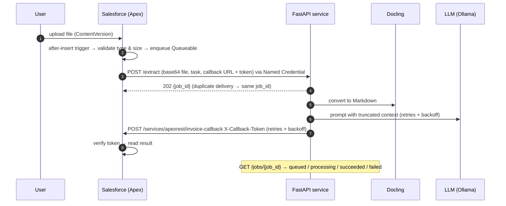

# Salesforce → LLM Document Pipeline


Upload a PDF, Word or Excel file in Salesforce and get an LLM answer about it back in Salesforce, **asynchronously**:
no synchronous callout waits on a slow model, and one bad document cannot block the others.



## Why it is built this way

| Problem | Design choice |
|---|---|
| Apex callouts time out (120 s max) while LLMs on large files take minutes | **Submit → callback**: the Queueable only submits; the service answers `202` and calls back when done. `GET /jobs/{id}` adds polling. |
| Trigger fires for bulk uploads | Bulk-safe handler: type and size checked before enqueueing, capped at 45 Queueables per transaction. |
| Model or network hiccups | **Bounded retries with exponential backoff + jitter** on the LLM call and on the callback; only retryable errors (timeouts, connection errors, 429, 5xx) are retried. |
| At-least-once delivery (platform retries, user re-uploads) | **Idempotency key** = record id + task + SHA-256 of file content. A duplicate submission returns the existing `job_id` instead of processing twice. |
| One corrupt document | **Failure isolation**: errors are caught per job, reported to Salesforce as a failed result, and the service keeps serving. A failed job can be re-submitted. |
| Large documents vs context window | Docling converts to Markdown, then the text is truncated to a word budget (`MAX_WORDS`); the callback says whether it was truncated. |
| Abuse of the callback | The service only calls back to `https` Salesforce hosts on the Apex REST path, and the Apex endpoint rejects calls without the shared callback token (stored in a protected hierarchy custom setting). The token is excluded from logs and reprs. |
| Secrets in code | Endpoint via a **Named Credential** (`callout:DocExtractionService`), service settings via environment variables. |

## Repository layout

```
salesforce/                         Salesforce DX project
  force-app/main/default/
    triggers/ContentVersionTrigger.trigger      after-insert entry point
    classes/ContentVersionTriggerHandler.cls    bulk-safe validation + per-type extraction prompt
    classes/FileExtractionCallout.cls           Queueable callout (base64 file + callback details)
    classes/InvoiceCallbackAPI.cls              Apex REST callback, token check, JSON responses
    classes/FileExtractionIntegrationTest.cls   Apex tests (trigger enqueue, skip, prompts, callback auth)
    objects/FileExtractionConfig__c             hierarchy custom setting holding the callback token
  scripts/set_callback_token.apex               one-time token setup (placeholder value)
python-service/                     FastAPI service
  app.py                 /extract (202 + job_id), /jobs/{id}, /health; background worker; idempotency
  document_processor.py  Docling conversion + context budget
  llm_service.py         prompt template + Ollama call with retries
  salesforce_client.py   callback client, URL allow-list, token from env or sf CLI
  retry.py               bounded exponential-backoff helper
  tests/                 18 pytest tests (Docling, LLM and Salesforce stubbed)
```

## Run it

**Python service**

```bash
cd python-service
pip install -r requirements.txt
cp .env.example .env            # set MODEL_NAME and SF_TARGET_ORG / SF_ACCESS_TOKEN
uvicorn app:app --port 8000
# tests (no Docling / LLM / org needed)
pip install -r requirements-dev.txt && pytest -q
```

Salesforce must reach the service over HTTPS. For local development expose port 8000 with a tunnel
(e.g. ngrok); in production deploy the container (`Dockerfile`) behind HTTPS.

**Salesforce**

```bash
cd salesforce
sf project deploy start --target-org my-dev-org
sf apex run --file scripts/set_callback_token.apex --target-org my-dev-org   # edit the placeholder first
sf apex run test --class-names FileExtractionIntegrationTest --target-org my-dev-org --result-format human
```

Then in Setup create a **Named Credential** `DocExtractionService` whose URL is the service's HTTPS base URL.
Upload a PDF/DOCX/XLSX to any record and watch the debug log and `GET /jobs/{job_id}`.

## Status and next steps

This is a working reference implementation, currently debug-oriented on the Salesforce side: the callback
validates and logs the result rather than writing it to a record.

- Persist results on a custom object keyed by `job_id` (upsert by external id → idempotent writes).
- Replace the shared token with an HMAC signature over timestamp + body.
- Move the in-memory job store to Redis/Firestore so the service can run as several replicas.
- Structured output (JSON schema) for invoice fields instead of free text.

## License

MIT
